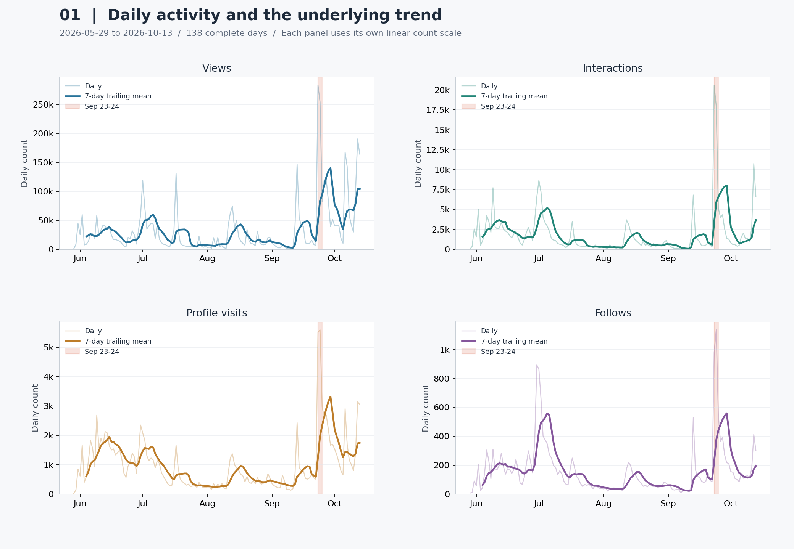
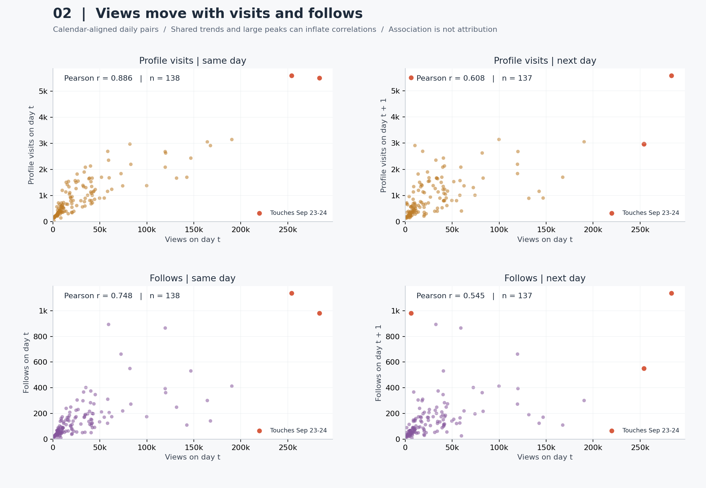
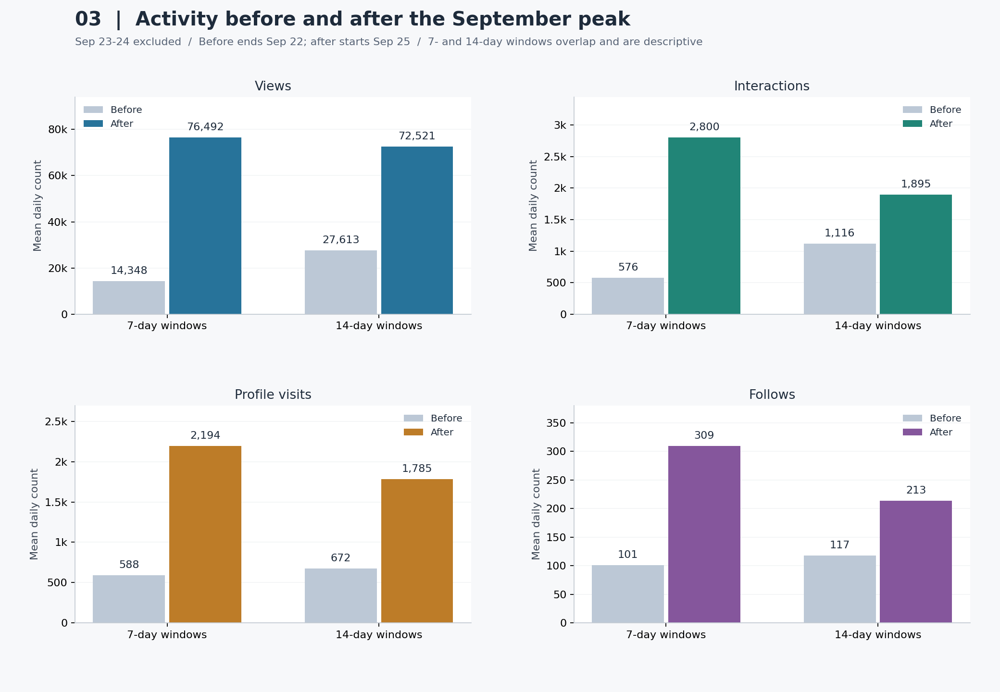
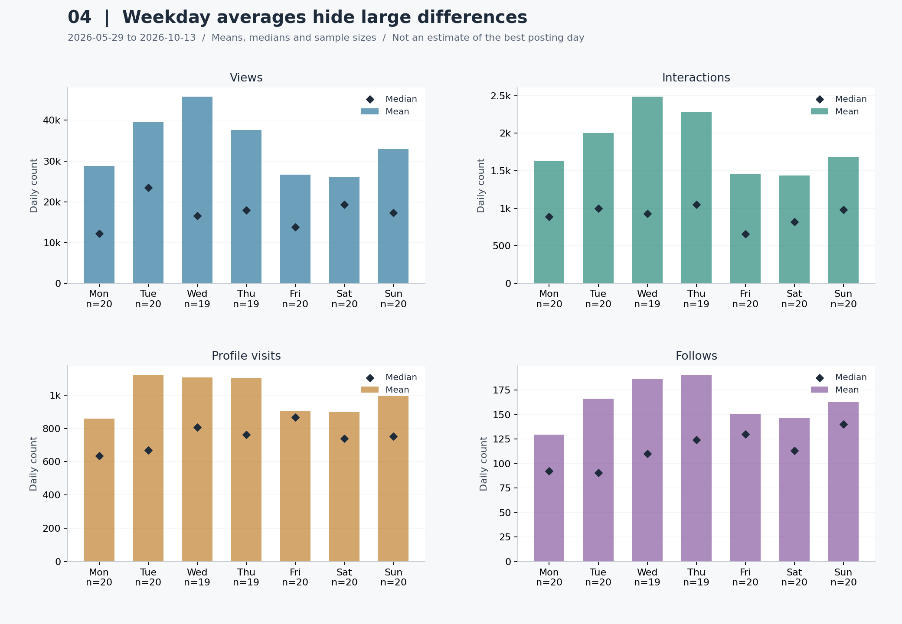

# 내 인스타그램 조회수 증가는 방문과 팔로우 증가로 이어졌을까?

> 분석 대상: 사용자 제공 Instagram 계정 성과 CSV 6개  
> 전체 기간: 2026-05-29 ~ 2026-10-14 (139일)  
> 지표 비교 기간: 2026-05-29 ~ 2026-10-13 (138일)

**핵심 답변:** 이 기간에는 조회수가 높은 날 프로필 방문과 팔로우 기록도 높은 경향이 있었다. 같은 날의 조회수–방문 상관계수는 **0.886**, 조회수–팔로우는 **0.748**였다. 다음 날보다 같은 날의 관계가 강했고, 이것만으로 조회가 방문이나 팔로우를 *발생시켰다*고 판단할 수는 없다.

9월 23~24일 급증을 제외한 직후 14일에도 직전 14일보다 조회수 일평균은 **2.63배**, 팔로우 일평균은 **1.82배**였다. 그러나 조회수 확대와 팔로우 기록의 확대는 같은 비율로 나타나지 않았다.

## 1. 분석 주제와 선정 이유

본인 계정의 실제 운영 데이터를 이용해 노출 규모가 커진 시기와 이용자 행동 지표가 함께 증가한 시기를 확인한다. 성과가 단순히 일시적인 급등인지, 급등 이후 관측 기간에도 높은 수준을 유지했는지 살펴본다. 결과는 다음 콘텐츠 실험에서 기록하고 비교할 지표를 고르는 데 활용한다.

원본에는 콘텐츠별 업로드 시각, 광고 집행, 콘텐츠 주제, 개별 사용자의 이동 경로가 없다. 따라서 이번 분석의 대상은 **계정 단위 일별 지표의 연관성과 시간 변화**다.

## 2. 분석 질문

1. 조회수·상호작용·방문·팔로우의 수준은 시간에 따라 어떻게 변했는가?
2. 조회수가 많은 날에는 방문과 팔로우도 많은가? 같은 날과 다음 날의 관계는 다른가?
3. 9월 23~24일 급증 이후 7일·14일에도 직전보다 높은 수준이 유지됐는가?
4. 요일별 성과 차이가 있는가? 평균과 중앙값은 같은 요일을 가리키는가?

## 3. 데이터와 출처

- 출처: 사용자가 Instagram 분석 화면에서 내려받아 제공한 성과 CSV. Meta 내보내기 형식의 `sep=,`, 지표 제목, `Date,Primary` 구조를 확인했다.
- 보관: [data/raw](data/raw)에 원본 바이트를 그대로 복사했다. 행을 추가하거나 수치를 수정하지 않았다.
- 빈도·단위: 일 단위 집계, 날짜 1개가 관측 시점 1개다. 지표 6개를 곱해 시점을 부풀리지 않는다.
- 포맷: UTF-16 원본을 읽어 UTF-8 BOM CSV로 정제한다. `Date`는 날짜, `Primary`는 해당 지표의 값이다.
- 시간대: 원본에는 시간대가 없다. `T00:00:00`을 집계 날짜 라벨로 취급하며 한국 시간으로 재해석하거나 변환하지 않는다.
- 정확한 다운로드 설정, 광고 포함 여부, 교차 게시 포함 여부, 집계 확정 시점은 CSV에 없어 확인되지 않았다. 마지막 날짜의 잠정 집계 가능성도 남는다.

| 원본 | 기간 | 행 수 | 빈 값 | 0인 날 | 높은 값 표시* |
| --- | --- | --- | --- | --- | --- |
| Views.csv | 2026-05-29~2026-10-14 | 139 | 0 | 0 | 13 |
| Viewers.csv | 2026-05-29~2026-10-14 | 139 | 0 | 0 | 16 |
| Interactions.csv | 2026-05-29~2026-10-14 | 139 | 0 | 0 | 11 |
| Visits.csv | 2026-05-29~2026-10-14 | 139 | 0 | 0 | 6 |
| Follows.csv | 2026-05-29~2026-10-13 | 138 | 0 | 0 | 9 |
| Link clicks.csv | 2026-05-29~2026-10-14 | 139 | 0 | 137 | 2 |

\* 높은 값 표시: 각 지표 전체 관측값에서 `Q3 + 1.5 × IQR`을 초과한 날. 원본 오류 판정이 아니며 삭제하지 않았다. 성장 추세가 있는 시계열에서는 이 기준이 후반의 정상적인 높은 값을 많이 표시할 수 있다.

각 파일의 자체 기간 안에는 누락 날짜·중복 날짜·빈 숫자 값이 없다. 파일을 합친 139일 달력에서는 **2026-10-14의 팔로우만 결측**이다. 138일 공통 기간이 과제의 최소 100시점 조건을 충족한다. 이 검사는 파일의 형식과 완결성을 확인한 것이며 플랫폼 집계의 진실성까지 검증한 것은 아니다.

### 지표를 읽는 기준

| 코드 컬럼 | 원본 제목 | 이번 분석의 해석과 제한 |
| --- | --- | --- |
| `views` | Views | 일별 조회수 지표. 동일인의 반복 조회를 분리할 수 없다. |
| `viewers` | Viewers | 원본의 일별 시청자 지표. 날짜 간 중복을 제거할 수 없으므로 합계를 기간 전체 고유 시청자 수로 제시하지 않는다. |
| `interactions` | Content interactions | 콘텐츠 상호작용 지표. 좋아요·댓글·공유 등 하위 구성은 이 CSV로 확인할 수 없다. |
| `visits` | Instagram profile visits | 프로필 방문 지표. 조회한 사용자와 방문한 사용자의 일치 여부는 확인할 수 없다. |
| `follows` | Instagram follows | 해당 날짜의 팔로우 지표. 전체 팔로워 수나 언팔로우를 차감한 순증가로 해석하지 않는다. |
| `link_clicks` | Instagram link clicks | 링크 클릭 지표. 구체적인 링크 위치·설정 변경 여부는 알 수 없다. |

지표별 세부 정의는 원본 제목의 범위를 넘겨 확정하지 않았다. 고유 사용자·기여 행동의 구분이 필요한 추가 분석에는 내보내기 화면의 정의와 설정을 함께 보관해야 한다.

## 4. 정제와 분석 방법

1. **형식 검증:** 지표 제목과 컬럼, 날짜, 중복, 음수·비정수·무한값을 검사한다. 잘못된 파일은 조용히 제외하지 않고 오류로 알린다.
2. **날짜 결합:** 시간순으로 정렬해 하루 단위 달력에 결합한다. 기록 없는 날은 결측으로 남긴다. 결측과 실제 `0`을 구분한다.
3. **기간 통일:** 전체 정제 데이터는 139일을 보존한다. 모든 본문 그래프와 주요 비교는 팔로우까지 갖춘 138일을 사용한다. 마지막 하루 팔로우를 0 또는 직전 값으로 채우지 않는다.
4. **이상치 처리:** IQR로 큰 값을 표시하되 보존한다. 9월 급증은 조회수·시청자·상호작용 및 방문·팔로우에서 근접한 시점에 나타나 실제 반응일 가능성이 있으나, 원본 오류 여부를 외부에서 확인한 것은 아니다.
5. **이동평균:** 당일과 이전 6일의 산술평균을 사용한다. 완전한 7일이 없는 첫 6일은 빈 값이다. 7일은 요일 단위 변동을 완화하기 위한 관찰 창이지 계절성이 입증됐다는 뜻은 아니다.
6. **변화율:** `(당일−전일)/전일×100`. 전일이 0이거나 값이 없으면 계산하지 않는다. 보간이나 전방 채우기를 하지 않는다. 파생값은 `derived.csv`에 남긴다.
7. **연관성:** Pearson은 값의 선형 동반 움직임, Spearman은 순위의 동반 움직임을 비교한다. 다음 날 비교는 `조회수(t)`와 `행동(t+1일)`을 날짜로 연결한다. 결측 뒤의 다음 행을 다음 날로 오인하지 않는다.
8. **민감도 확인:** 9월 23~24일이 원인 날짜 또는 결과 날짜에 포함된 쌍을 제외한 상관계수를 계산한다. 원자료 대신 하루 증감량의 상관도 계산해 공통 추세의 영향을 살펴본다. 이런 점검도 교란변수를 제거하거나 인과관계를 증명하지는 못한다.
9. **구간·요일 집계:** 급증 이틀을 제외한 직전·직후 7일/14일을 비교한다. 요일별로 평균·중앙값·일수를 함께 제시한다. 5월·10월은 부분 월이므로 월 합계보다 일평균을 제시하고 포함 일수를 밝힌다.

**용어:** 추세는 시간에 따른 수준의 장기적인 움직임, 계절성은 일정한 주기로 반복되는 패턴, 노이즈는 그 외의 변동이다. 이 짧은 관측 구간에서 요일별 평균이 다르다는 사실만으로 안정적인 주간 계절성을 확정하지 않는다.

## 5. 분석 결과와 시각화

### 5.1 전체 추이와 성장 수준



**읽는 법:** 옅은 선은 일별 값, 진한 선은 과거 7일 이동평균, 주황색 배경은 9월 23~24일이다. 각 패널은 지표별 선형 축을 사용한다. 패널 간 높이를 직접 비교하지 않는다. `k`는 천 단위다. 실행 환경별 한글 폰트 문제를 피하기 위해 그림 안의 축은 영문, 해석은 한글로 작성했다.

| 지표 | 공통 기간 합계 | 일평균 | 중앙값 | 최고 기록 (날짜) |
| --- | --- | --- | --- | --- |
| 조회수 | 4,667,510 | 33,822.5 | 17,735.5 | 283,550 (2026-09-23) |
| 상호작용 | 254,656 | 1,845.3 | 956.0 | 20,627 (2026-09-23) |
| 프로필 방문 | 137,498 | 996.4 | 713.0 | 5,591 (2026-09-24) |
| 팔로우 | 22,265 | 161.3 | 109.0 | 1,136 (2026-09-24) |

팔로우 합계는 일별 팔로우 지표를 합한 값이며 계정의 현재 팔로워 수 또는 순증가가 아니다.

| 지표 | 첫 28일 평균 | 마지막 28일 평균 | 평균 비율 | 마지막 28일 중 급증 2일 제외 평균 (26일) |
| --- | --- | --- | --- | --- |
| 조회수 | 23,418.9 | 77,838.6 | 3.32배 | 63,152.2 |
| 상호작용 | 2,232.6 | 3,268.8 | 1.46배 | 2,035.5 |
| 프로필 방문 | 1,258.3 | 1,770.6 | 1.41배 | 1,480.0 |
| 팔로우 | 151.2 | 247.8 | 1.64배 | 185.4 |

첫 28일은 **5/29~6/25**, 마지막 28일은 **9/16~10/13**이다. 마지막 28일에서 급증 이틀을 뺀 값은 **26일 평균**이므로 보조 민감도 비교로만 사용한다. 상호작용·방문·팔로우가 조회수와 같은 배율로 증가한 것은 아니다.

| 월 | 포함 일수 | 조회수 일평균 | 방문 일평균 | 팔로우 일평균 |
| --- | --- | --- | --- | --- |
| 2026-05 | 3 | 17,964.7 | 338.0 | 36.7 |
| 2026-06 | 30 | 25,309.7 | 1,375.7 | 201.8 |
| 2026-07 | 31 | 25,106.1 | 710.5 | 182.5 |
| 2026-08 | 31 | 18,363.7 | 508.4 | 74.0 |
| 2026-09 | 30 | 48,673.6 | 1,229.6 | 201.3 |
| 2026-10 | 13 | 80,503.8 | 1,580.0 | 162.2 |

**관찰:** 마지막 28일의 조회수 일평균은 첫 28일의 3.32배지만, 6~8월에 지속적으로 상승한 형태는 아니다. 큰 값 상위 5일이 공통 기간 조회수 합계의 **22.7%**를 차지한다.

**해석:** 일부 높은 성과의 날짜와 후반의 수준 상승이 함께 존재한다. ‘매일 꾸준히 성장했다’는 표현보다 ‘후반에 높은 수준을 기록했지만 변동과 집중도가 컸다’는 표현이 정확하다.

### 5.2 조회수와 방문·팔로우의 관계



**읽는 법:** 점 하나는 날짜 쌍 하나다. 왼쪽은 같은 날, 오른쪽은 다음 날 행동 지표다. 빨간 점은 두 날짜 중 하나가 9/23~24에 걸친다. 모든 패널의 축은 0에서 시작하며 회귀선이나 전환 경로를 가정하지 않는다.

| 대상 | 시차 | 자료 | 쌍 수 | Pearson r | Spearman ρ |
| --- | --- | --- | --- | --- | --- |
| 프로필 방문 | 0일 | 전체 | 138 | 0.886 | 0.879 |
| 프로필 방문 | 0일 | 9/23~24 관련 쌍 제외 | 136 | 0.818 | 0.874 |
| 프로필 방문 | 0일 | 전일 대비 증감량 | 137 | 0.903 | 0.747 |
| 프로필 방문 | 1일 | 전체 | 137 | 0.608 | 0.706 |
| 프로필 방문 | 1일 | 9/23~24 관련 쌍 제외 | 134 | 0.576 | 0.714 |
| 프로필 방문 | 1일 | 전일 대비 증감량 | 136 | -0.028 | 0.002 |
| 팔로우 | 0일 | 전체 | 138 | 0.748 | 0.800 |
| 팔로우 | 0일 | 9/23~24 관련 쌍 제외 | 136 | 0.606 | 0.791 |
| 팔로우 | 0일 | 전일 대비 증감량 | 137 | 0.757 | 0.560 |
| 팔로우 | 1일 | 전체 | 137 | 0.545 | 0.701 |
| 팔로우 | 1일 | 9/23~24 관련 쌍 제외 | 134 | 0.442 | 0.709 |
| 팔로우 | 1일 | 전일 대비 증감량 | 136 | 0.115 | 0.098 |

**관찰:** 조회수–팔로우의 같은 날 Pearson 상관은 **0.748**, 다음 날은 **0.545**이다. 급증 이틀 관련 쌍을 빼도 같은 날 상관은 **0.606**다. 일별 증감량으로 바꾸면 다음 날 팔로우와의 상관은 **0.115**로 약해진다.

**해석:** 관심과 행동이 같은 시기에 함께 움직인다는 근거는 있지만, ‘조회 후 하루 뒤 팔로우가 발생한다’는 일관된 지연 효과의 증거는 약하다. 한 번의 최고점 시차를 전체 기간의 행동 규칙으로 일반화하면 안 된다. 상관계수는 독립 표본의 유의성 검정을 하지 않은 기술통계이며 시계열 자기상관의 영향을 받을 수 있다.

### 5.3 급증 이후 수준 유지



| 창 길이 | 직전 구간 | 제외한 구간 | 직후 구간 |
| --- | --- | --- | --- |
| 7일 | 9/16~9/22 | 9/23~9/24 | 9/25~10/1 |
| 14일 | 9/9~9/22 | 9/23~9/24 | 9/25~10/8 |

| 지표 | 기간 길이 | 직전 일평균 | 직후 일평균 | 직후/직전 | 변화율 |
| --- | --- | --- | --- | --- | --- |
| 조회수 | 7일 | 14,347.9 | 76,491.7 | 5.33배 | +433.1% |
| 상호작용 | 7일 | 575.7 | 2,800.4 | 4.86배 | +386.4% |
| 프로필 방문 | 7일 | 587.7 | 2,193.6 | 3.73배 | +273.2% |
| 팔로우 | 7일 | 100.6 | 309.0 | 3.07배 | +207.2% |
| 조회수 | 14일 | 27,613.0 | 72,520.8 | 2.63배 | +162.6% |
| 상호작용 | 14일 | 1,115.6 | 1,895.2 | 1.70배 | +69.9% |
| 프로필 방문 | 14일 | 672.2 | 1,785.2 | 2.66배 | +165.6% |
| 팔로우 | 14일 | 117.4 | 213.1 | 1.82배 | +81.5% |

**관찰:** 급증한 이틀을 제외해도 직후 14일 팔로우 일평균은 **213.1**, 직전은 **117.4**로 **1.82배**다. 조회수 일평균도 **2.63배**였다.

**해석:** 이 14일 구간에서는 높은 수준이 남았다고 말할 수 있다. 다만 최고점을 보고 사후에 구간을 골랐고 이후 새 콘텐츠·광고·추천 노출을 통제하지 않았다. ‘급증이 영구적인 성장을 만들었다’는 인과적·장기적 결론을 내릴 수 없다. 7일과 14일 창은 겹치므로 독립적인 두 번의 검증이 아니다.

### 5.4 요일별 평균과 중앙값



**읽는 법:** 막대는 평균, 마름모는 중앙값, `n`은 해당 요일의 관측 일수다. 평균과 중앙값이 크게 다르면 소수의 높은 값이 영향을 주었을 수 있다.

| 요일 | 일수 | 조회수 평균 | 조회수 중앙값 | 팔로우 평균 | 팔로우 중앙값 |
| --- | --- | --- | --- | --- | --- |
| 월 | 20 | 28,793.0 | 12,195.0 | 129.4 | 92.5 |
| 화 | 20 | 39,569.9 | 23,428.5 | 166.3 | 90.5 |
| 수 | 19 | 45,775.6 | 16,551.0 | 186.6 | 110.0 |
| 목 | 19 | 37,647.1 | 17,939.0 | 190.3 | 124.0 |
| 금 | 20 | 26,661.3 | 13,807.5 | 150.1 | 130.0 |
| 토 | 20 | 26,154.2 | 19,353.5 | 146.8 | 113.0 |
| 일 | 20 | 32,945.6 | 17,337.0 | 162.5 | 140.0 |

**관찰:** 조회수 평균이 가장 높은 요일은 **수요일(45,775.6)**이지만, 그 요일의 중앙값은 **16,551.0**이다. 중앙값 1위는 **화요일**이다.

**해석:** 평균만으로 ‘수요일에 올려야 한다’고 결론 내릴 수 없다. 이는 성과가 발생한 요일이며 업로드한 요일이 아니다. 실제 게시 날짜·콘텐츠 종류·게시 후 경과 시간도 필요하다.

## 6. 인사이트와 다음 행동

| 인사이트 | 관찰 — 수치와 근거 | 해석 — 검증되지 않은 가설 | 다음 행동 |
| --- | --- | --- | --- |
| 1. 조회 규모 확대와 팔로우 확대의 비율은 다르다 | 첫/마지막 28일 조회수 평균은 3.32배. 조회수 1,000회당 팔로우 지표는 6.46 → 3.18 (그림 1, 각 구간 합계의 비율) | 더 넓은 관심층으로 노출됐거나 반복 조회·콘텐츠 구성이 달라졌을 수 있다. 실제 전환율 하락으로 단정할 수 없다 | 다음 콘텐츠에서 주제, 방문 유도 문구, 업로드 후 같은 경과 기간의 지표를 함께 기록 |
| 2. 다음 날보다 같은 날의 동반 움직임이 강하다 | 조회수–팔로우 r=0.748(당일), 0.545(다음 날). 급증 관련 쌍 제외 당일 r=0.606 (그림 2) | 동시 반응 또는 콘텐츠·추천 노출이라는 공통 원인이 있을 수 있다 | 다음 운영 실험에서는 조회수와 방문·팔로우를 같은 일자와 동일한 집계 기간으로 함께 점검 |
| 3. 급증 이틀 밖에도 높은 수준이 관측된다 | 직후 14일 평균이 직전 대비 조회수 2.63배, 팔로우 1.82배 (그림 3) | 노출 확대가 이어졌거나 뒤이은 콘텐츠가 영향을 줬을 수 있다 | 당시 게시 이력과 광고 여부를 붙여 비교하고, 이후 4~8주 데이터가 확보되면 지속성 재확인 |
| 4. 평균만으로 최적 요일을 정하기 어렵다 | 조회수 평균 1위 수요일, 중앙값 1위 화요일 (그림 4) | 특정 날짜의 높은 성과와 게시 일정이 요일 평균을 좌우했을 수 있다 | 비슷한 주제·형식의 콘텐츠를 여러 요일에 반복하고 동일한 경과 시간의 성과를 비교 |

조회수 1,000회당 행동 지표는 `구간 행동 합계 ÷ 같은 구간 조회수 합계 × 1,000`이다. 일별 비율을 단순 평균하지 않았다. 사용자별 경로가 연결되지 않았으므로 **사용자 전환율이 아닌 집계 지표 간 비율**이다.

### 링크 클릭 보조 점검

| 날짜 | 클릭 수 |
| --- | --- |
| 2026-10-06 | 171 |
| 2026-10-07 | 7 |

전체 139일 중 137일이 0이다. 0을 누락으로 바꾸지는 않지만, 실제 무클릭·링크 미운영·집계 변화 중 무엇인지 원본만으로 구분할 수 없다. 링크 설정·캠페인 이력을 먼저 확인해야 하므로 주요 성장 지표에서 제외했다.

## 7. 결론과 한계

관측 기간의 후반에는 조회수와 여러 행동 지표가 높은 수준을 기록했고, 같은 날의 조회수·방문·팔로우가 동반 움직였다. 그러나 ‘조회 증가가 팔로우 증가를 일으켰다’, ‘하루 뒤 전환된다’, ‘특정 요일이 최적이다’라는 결론은 현재 자료가 뒷받침하지 못한다.

- **기여·인과 한계:** 사용자별 경로, 광고, 업로드 수·내용, 기존 팔로워 규모, 외부 이벤트를 통제하지 않았다.
- **성장 정의:** 언팔로우와 전체 팔로워 잔액이 없으므로 순성장·유지율을 계산할 수 없다.
- **기간 한계:** 한 계정의 약 4.5개월이며 연간 계절성·장기 추세·다른 계정에 대한 일반화는 어렵다.
- **통계 한계:** 일별 자기상관, 비정상성, 사후 선택한 극값과 구간이 해석에 영향을 준다. 독립적인 인과 실험·예측 모델·통계적 유의성 주장을 하지 않았다.
- **정의·수집 한계:** 시간대, 광고·교차 게시 포함 여부, 플랫폼 지표 정의 변경 및 누락 집계 여부가 원본에 기록되지 않았다. 원본의 숫자 `0`이 실제 활동 부재인지도 별도 확인이 필요하다.
- **추가 자료:** 콘텐츠별 업로드 일시·형식·주제, 광고 날짜·금액, 언팔로우 및 누적 팔로워 수가 있으면 설명력을 높일 수 있다.

## 8. 재현 방법과 산출물

Python 3.10 이상에서 다음을 실행한다. OS별 가상환경 활성화와 전체 안내는 [README.md](README.md)를 참고한다.

```bash
python -m pip install -r requirements.txt
python analysis.py
python -m unittest discover -s tests -v
```

- 정제 데이터: [daily.csv](data/processed/daily.csv), [common.csv](data/processed/common.csv)
- 파생값: [derived.csv](data/processed/derived.csv)
- 수집·품질·원본 해시: [audit.csv](data/processed/audit.csv)
- 검증 가능한 통계: [correlations.csv](data/processed/correlations.csv), [periods.csv](data/processed/periods.csv), [summary.json](data/processed/summary.json)
- 월별·요일별 집계: [monthly.csv](data/processed/monthly.csv), [weekday.csv](data/processed/weekday.csv)
- 코드: [analysis.py](analysis.py), 해석 원문: [REPORT.template.md](templates/REPORT.template.md)

`analysis.py`를 실행하면 표·그래프·이 리포트를 다시 만든다. 해석을 고칠 때는 생성된 REPORT.md만 고치지 말고 템플릿을 수정해야 한다. 이 리포트는 현재 제공된 기간과 9월 급증 구간에 맞춘 사례 분석이므로 다른 계정·기간으로 교체하면 문장·구간 선택도 재검토해야 한다.

## 9. AI 사용 로그

실제 진행한 작업을 기록했다. 사용자가 확인하지 않은 판단을 사용자 검증 완료로 적지 않는다.

| 사용 작업 | 사용 이유 | 검증 방법과 상태 |
| --- | --- | --- |
| 분석 질문·범위 설계 | 과제 조건을 실제 자료에 맞추고 비교 가능한 기간 선택 | 사용자가 제시된 전체 구성을 승인. 실제 파일에서 139일/138일 범위 확인 |
| 전처리·분석 Python 코드 작성 | 반복 가능한 날짜 결합·계산 자동화 | 실제 원본으로 실행. 결측·0·중복·잘못된 값·시차·구간 제외를 테스트로 점검 |
| 시각화 코드 작성 | 질문별 비교 그래프 구성 | 생성된 PNG 4개를 시각적으로 확인하고 축·표본 수·기간을 계산 결과와 대조 |
| 수치·해석 초안 작성 | 결과 설명과 대안 가설 탐색 | 원본 CSV를 별도로 읽어 합계·최고점·전후 평균을 대조. 다음 날 관계 및 급증 제외 비교로 초안 가설 점검 |
| 리포트 문장 정리 | 관찰·가설·행동과 한계 구분 | 수치가 코드에서 채워지도록 구성. 콘텐츠·광고 맥락의 원인 가설은 미확인 상태로 유지 |

AI가 제시한 해석은 사용자의 최종 판단을 대신하지 않는다. 제출자는 주요 수치, 결측 처리, 인과 추론의 한계를 직접 설명하고 자신의 운영 맥락에 따라 문장을 수정해야 한다.

## 10. 출처·이용 범위

데이터의 직접 출처는 제공된 원본 파일이며 재수집 과정은 [DATA_SOURCE.md](DATA_SOURCE.md)에 기록했다. 공개 데이터셋의 자유 이용 라이선스를 가정하지 않는다. 이 계정 성과 데이터와 그래프를 공개 저장소에 재배포할지는 계정 소유자가 결정해야 한다.

계산 API 참고: [pandas 상관계수 문서](https://pandas.pydata.org/pandas-docs/stable/reference/api/pandas.DataFrame.corr.html), [pandas 변화율 문서](https://pandas.pydata.org/docs/reference/api/pandas.DataFrame.pct_change.html). 코드는 지정한 라이브러리 버전으로 실행했으며, 문서의 일반 정의를 원본 데이터의 플랫폼 집계 정의와 혼동하지 않는다.
