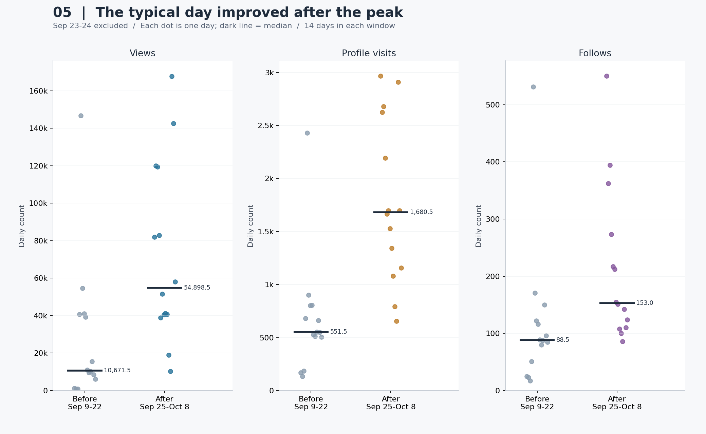

# 공대생 콘텐츠는 언제 반응을 얻을까?

**게시물 주제와 학기 흐름으로 읽는 인스타그램 트렌드**

> 분석 대상: 사용자 제공 Instagram 계정 성과 CSV 6개  
> 전체 기간: 2026-05-29 ~ 2026-10-14 (139일)  
> 지표 비교 기간: 2026-05-29 ~ 2026-10-13 (138일)

**핵심 결론: 9월 하순에는 평소 성과 수준까지 올라갔지만, 10월 재상승은 조회수에 비해 팔로우 확보가 약했다. 다음 운영의 우선순위는 높은 조회수를 다음 콘텐츠에 대한 관심으로 연결하는 것이다.**

| 데이터로 답할 수 있는 질문 | 이번 분석의 답 | 운영에 주는 의미 |
| --- | --- | --- |
| 9월 성과는 급증 이틀만의 착시였나? | 아니다. 급증 이틀을 뺀 전후 14일의 조회수 중앙값은 5.14배로 높아졌고, 직후 14일 중 13일이 직전 중앙값을 넘었다. | 반응이 좋았던 시기의 후속 콘텐츠를 운영할 근거가 있다. |
| 10월에도 9월처럼 팔로우를 확보했나? | 아니다. 두 상승 주간의 조회수 1,000회당 팔로우는 3.99 → 1.65, 58.5% 낮아졌다. | 조회수와 팔로우 확보를 별도 목표로 관리해야 한다. |
| ‘개강하면 자연스럽게 잘 된다’고 볼 수 있나? | 9/1~11 조회수 일평균은 4,012.3회로 8월보다 낮았다. 월 전체보다 실제 반응이 바뀐 구간을 봐야 한다. | 학기명만으로 편성하지 말고, 구체적인 학습 필요와 주제·연재 구성을 함께 기록한다. |

이 표는 관측된 기간의 결과다. **원인을 하나로 확정하지 못해도 성과의 차이와 다음 실험의 우선순위는 정할 수 있다.** 사용자별 전환 경로가 없으므로 아래의 ‘조회수당 팔로우’는 계정 집계 비율로 해석한다.

## 1. 분석 주제와 선정 이유

직접 운영하는 공대생 대상 계정의 실제 데이터를 이용해 노출 규모가 커진 시기와 이용자 행동 지표가 함께 증가한 시기를 확인한다. 중심 질문은 ‘관심을 많이 받은 시기와 팔로우를 잘 확보한 시기는 같았을까?’다. 성과가 일시적인 급등인지, 이후 관측 기간에도 높은 수준이 이어졌는지 살펴본다.

운영자는 게시물 주제와 방학·개강·중간고사 준비 시기가 맞물렸을 가능성을 제안했다. 이 설명을 검토하기 위해 인스타그램 원문에서 게시물 사례 2개를 추가 확인했다(5.5절). 원본 CSV에는 콘텐츠별 업로드 시각·광고 집행·개별 사용자의 이동 경로가 없으므로 정량 분석의 대상은 **계정 단위 일별 지표의 연관성과 시간 변화**다.

## 2. 분석 질문

1. 조회수·상호작용·방문·팔로우의 수준은 시간에 따라 어떻게 변했는가?
2. 조회수가 많은 날에는 방문과 팔로우도 많은가? 같은 날과 다음 날의 관계는 다른가?
3. 9월 23~24일 급증 이후에도 전형적인 하루의 성과가 높아졌는가? 중앙값과 높은 값 제외 비교에서도 같은가?
4. 요일별 성과 차이가 있는가? 평균과 중앙값은 같은 요일을 가리키는가?
5. 9월과 10월의 상승 주간은 조회수당 팔로우 확보에서 어떻게 다른가? 방문/조회와 팔로우/방문 중 어느 비율이 달라졌는가?
6. 실제 게시물 주제와 학기·시험 준비 맥락은 성과 변화에 어떤 설명 가설을 제공하는가? (사례 검토)

## 3. 데이터와 출처

- 출처: 사용자가 Instagram 분석 화면에서 내려받아 제공한 성과 CSV. Meta 내보내기 형식의 `sep=,`, 지표 제목, `Date,Primary` 구조를 확인했다.
- 보관: [data/raw](data/raw)에 원본 바이트를 그대로 복사했다. 행을 추가하거나 수치를 수정하지 않았다.
- 빈도·단위: 일 단위 집계, 날짜 1개가 관측 시점 1개다. 지표 6개를 곱해 시점을 부풀리지 않는다.
- 포맷: UTF-16 원본을 읽어 UTF-8 BOM CSV로 정제한다. `Date`는 날짜, `Primary`는 해당 지표의 값이다.
- 시간대: 원본에는 시간대가 없다. `T00:00:00`을 집계 날짜 라벨로 취급하며 한국 시간으로 재해석하거나 변환하지 않는다.
- 정확한 다운로드 설정, 광고 포함 여부, 교차 게시 포함 여부, 집계 확정 시점은 CSV에 없어 확인되지 않았다. 마지막 날짜의 잠정 집계 가능성도 남는다.
- 보조 자료: 인스타그램 게시물 표지 캡처 2개와 공개 원문 링크. 수집일은 2026-10-15이며 [사례 기록](data/context/README.md)에 날짜와 확인 범위를 남겼다. 시계열 분석 표본을 추가한 것이 아니다.

| 원본 | 기간 | 행 수 | 빈 값 | 0인 날 | 높은 값 표시* |
| --- | --- | --- | --- | --- | --- |
| Views.csv | 2026-05-29~2026-10-14 | 139 | 0 | 0 | 13 |
| Viewers.csv | 2026-05-29~2026-10-14 | 139 | 0 | 0 | 16 |
| Interactions.csv | 2026-05-29~2026-10-14 | 139 | 0 | 0 | 11 |
| Visits.csv | 2026-05-29~2026-10-14 | 139 | 0 | 0 | 6 |
| Follows.csv | 2026-05-29~2026-10-13 | 138 | 0 | 0 | 9 |
| Link clicks.csv | 2026-05-29~2026-10-14 | 139 | 0 | 137 | 2 |

\* 높은 값 표시: 각 지표 전체 관측값에서 `Q3 + 1.5 × IQR`을 초과한 날. 원본 오류 판정이 아니며 삭제하지 않았다. 성장 추세가 있는 시계열에서는 이 기준이 후반의 정상적인 높은 값을 많이 표시할 수 있다.

각 파일의 자체 기간 안에는 누락 날짜·중복 날짜·빈 숫자 값이 없다. 파일을 합친 139일 달력에서는 **2026-10-14의 팔로우만 결측**이다. 138일 공통 기간이 과제의 최소 100시점 조건을 충족한다. 이 검사는 파일의 형식과 완결성을 확인한 것이며 플랫폼 집계의 진실성까지 검증한 것은 아니다.

### 지표를 읽는 기준

| 코드 컬럼 | 원본 제목 | 이번 분석의 해석과 제한 |
| --- | --- | --- |
| `views` | Views | 일별 조회수 지표. 동일인의 반복 조회를 분리할 수 없다. |
| `viewers` | Viewers | 원본의 일별 시청자 지표. 날짜 간 중복을 제거할 수 없으므로 합계를 기간 전체 고유 시청자 수로 제시하지 않는다. |
| `interactions` | Content interactions | 콘텐츠 상호작용 지표. 좋아요·댓글·공유 등 하위 구성은 이 CSV로 확인할 수 없다. |
| `visits` | Instagram profile visits | 프로필 방문 지표. 조회한 사용자와 방문한 사용자의 일치 여부는 확인할 수 없다. |
| `follows` | Instagram follows | 해당 날짜의 팔로우 지표. 전체 팔로워 수나 언팔로우를 차감한 순증가로 해석하지 않는다. |
| `link_clicks` | Instagram link clicks | 링크 클릭 지표. 구체적인 링크 위치·설정 변경 여부는 알 수 없다. |

지표별 세부 정의는 원본 제목의 범위를 넘겨 확정하지 않았다. 고유 사용자·기여 행동의 구분이 필요한 추가 분석에는 내보내기 화면의 정의와 설정을 함께 보관해야 한다.

## 4. 정제와 분석 방법

1. **형식 검증:** 지표 제목과 컬럼, 날짜, 중복, 음수·비정수·무한값을 검사한다. 잘못된 파일은 조용히 제외하지 않고 오류로 알린다.
2. **날짜 결합:** 시간순으로 정렬해 하루 단위 달력에 결합한다. 기록 없는 날은 결측으로 남긴다. 결측과 실제 `0`을 구분한다.
3. **기간 통일:** 전체 정제 데이터는 139일을 보존한다. 모든 본문 그래프와 주요 비교는 팔로우까지 갖춘 138일을 사용한다. 마지막 하루 팔로우를 0 또는 직전 값으로 채우지 않는다.
4. **이상치 처리:** IQR로 큰 값을 표시하되 보존한다. 9월 급증은 조회수·시청자·상호작용 및 방문·팔로우에서 근접한 시점에 나타나 실제 반응일 가능성이 있으나, 원본 오류 여부를 외부에서 확인한 것은 아니다.
5. **이동평균:** 당일과 이전 6일의 산술평균을 사용한다. 완전한 7일이 없는 첫 6일은 빈 값이다. 7일은 요일 단위 변동을 완화하기 위한 관찰 창이지 계절성이 입증됐다는 뜻은 아니다.
6. **변화율:** `(당일−전일)/전일×100`. 전일이 0이거나 값이 없으면 계산하지 않는다. 보간이나 전방 채우기를 하지 않는다. 파생값은 `derived.csv`에 남긴다.
7. **연관성:** Pearson은 값의 선형 동반 움직임, Spearman은 순위의 동반 움직임을 비교한다. 다음 날 비교는 `조회수(t)`와 `행동(t+1일)`을 날짜로 연결한다. 결측 뒤의 다음 행을 다음 날로 오인하지 않는다.
8. **민감도 확인:** 9월 23~24일이 원인 날짜 또는 결과 날짜에 포함된 쌍을 제외한 상관계수를 계산한다. 원자료 대신 하루 증감량의 상관도 계산해 공통 추세의 영향을 살펴본다. 이런 점검도 교란변수를 제거하거나 인과관계를 증명하지는 못한다.
9. **구간·요일 집계:** 급증 이틀을 제외한 직전·직후 7일/14일을 비교한다. 요일별로 평균·중앙값·일수를 함께 제시한다. 5월·10월은 부분 월이므로 월 합계보다 일평균을 제시하고 포함 일수를 밝힌다.

10. **전형적인 하루와 극값 민감도:** 9/9~22와 9/25~10/8의 중앙값, 각 지표별 상위 2일을 각각 제외한 12일 평균, 직후 값이 직전 중앙값을 넘은 일수를 비교한다. 큰 값을 없애 정답을 만드는 것이 아니라 결론이 극값에만 의존하는지 확인한다.
11. **상승 주간의 성과 구성:** 9/23~29와 10/6~12를 비교한다. 각 7일이 모든 요일을 한 번씩 포함하므로 단순 요일 구성 차이를 줄인다. 두 상승의 시작을 보고 사후 선택한 사례이며 학사 일정의 효과 추정이나 무작위 실험은 아니다. 두 창을 동시에 ±1일 이동하고 각 창의 최대 조회일도 각각 제외해 방향을 확인한다.
12. **집계 비율:** 방문/조회, 팔로우/방문, 팔로우/조회 모두 같은 구간의 합계끼리 나눈다. `팔로우/조회 = (방문/조회) × (팔로우/방문)`은 산술 항등식이며 사용자의 실제 이동 경로를 가정하지 않는다. 분모가 0이면 비율을 계산하지 않는다.

**용어:** 추세는 시간에 따른 수준의 장기적인 움직임, 계절성은 일정한 주기로 반복되는 패턴, 노이즈는 그 외의 변동이다. 이 짧은 관측 구간에서 요일별 평균이 다르다는 사실만으로 안정적인 주간 계절성을 확정하지 않는다.

## 5. 분석 결과와 시각화

### 5.1 전체 추이와 성장 수준


**읽는 법:** 옅은 선은 일별 값, 진한 선은 과거 7일 이동평균, 주황색 배경은 9월 23~24일이다. 각 패널은 지표별 선형 축을 사용한다. 패널 간 높이를 직접 비교하지 않는다. `k`는 천 단위다. 실행 환경별 한글 폰트 문제를 피하기 위해 그림 안의 축은 영문, 해석은 한글로 작성했다.

| 지표 | 공통 기간 합계 | 일평균 | 중앙값 | 최고 기록 (날짜) |
| --- | --- | --- | --- | --- |
| 조회수 | 4,667,510 | 33,822.5 | 17,735.5 | 283,550 (2026-09-23) |
| 상호작용 | 254,656 | 1,845.3 | 956.0 | 20,627 (2026-09-23) |
| 프로필 방문 | 137,498 | 996.4 | 713.0 | 5,591 (2026-09-24) |
| 팔로우 | 22,265 | 161.3 | 109.0 | 1,136 (2026-09-24) |

팔로우 합계는 일별 팔로우 지표를 합한 값이며 계정의 현재 팔로워 수 또는 순증가가 아니다.

| 지표 | 첫 28일 평균 | 마지막 28일 평균 | 평균 비율 | 마지막 28일 중 급증 2일 제외 평균 (26일) |
| --- | --- | --- | --- | --- |
| 조회수 | 23,418.9 | 77,838.6 | 3.32배 | 63,152.2 |
| 상호작용 | 2,232.6 | 3,268.8 | 1.46배 | 2,035.5 |
| 프로필 방문 | 1,258.3 | 1,770.6 | 1.41배 | 1,480.0 |
| 팔로우 | 151.2 | 247.8 | 1.64배 | 185.4 |

첫 28일은 **5/29~6/25**, 마지막 28일은 **9/16~10/13**이다. 마지막 28일에서 급증 이틀을 뺀 값은 **26일 평균**이므로 보조 민감도 비교로만 사용한다. 상호작용·방문·팔로우가 조회수와 같은 배율로 증가한 것은 아니다.

| 월 | 포함 일수 | 조회수 일평균 | 방문 일평균 | 팔로우 일평균 |
| --- | --- | --- | --- | --- |
| 2026-05 | 3 | 17,964.7 | 338.0 | 36.7 |
| 2026-06 | 30 | 25,309.7 | 1,375.7 | 201.8 |
| 2026-07 | 31 | 25,106.1 | 710.5 | 182.5 |
| 2026-08 | 31 | 18,363.7 | 508.4 | 74.0 |
| 2026-09 | 30 | 48,673.6 | 1,229.6 | 201.3 |
| 2026-10 | 13 | 80,503.8 | 1,580.0 | 162.2 |

**관찰:** 마지막 28일의 조회수 일평균은 첫 28일의 3.32배지만, 6~8월에 지속적으로 상승한 형태는 아니다. 큰 값 상위 5일이 공통 기간 조회수 합계의 22.7%를 차지한다.

**해석:** 일부 높은 성과의 날짜와 후반의 수준 상승이 함께 존재한다. ‘매일 꾸준히 성장했다’는 표현보다 ‘후반에 높은 수준을 기록했지만 변동과 집중도가 컸다’는 표현이 정확하다.

### 5.2 조회수와 방문·팔로우의 관계


**읽는 법:** 점 하나는 날짜 쌍 하나다. 왼쪽은 같은 날, 오른쪽은 다음 날 행동 지표다. 빨간 점은 두 날짜 중 하나가 9/23~24에 걸친다. 모든 패널의 축은 0에서 시작하며 회귀선이나 전환 경로를 가정하지 않는다.

| 대상 | 시차 | 자료 | 쌍 수 | Pearson r | Spearman ρ |
| --- | --- | --- | --- | --- | --- |
| 프로필 방문 | 0일 | 전체 | 138 | 0.886 | 0.879 |
| 프로필 방문 | 0일 | 9/23~24 관련 쌍 제외 | 136 | 0.818 | 0.874 |
| 프로필 방문 | 0일 | 전일 대비 증감량 | 137 | 0.903 | 0.747 |
| 프로필 방문 | 1일 | 전체 | 137 | 0.608 | 0.706 |
| 프로필 방문 | 1일 | 9/23~24 관련 쌍 제외 | 134 | 0.576 | 0.714 |
| 프로필 방문 | 1일 | 전일 대비 증감량 | 136 | -0.028 | 0.002 |
| 팔로우 | 0일 | 전체 | 138 | 0.748 | 0.800 |
| 팔로우 | 0일 | 9/23~24 관련 쌍 제외 | 136 | 0.606 | 0.791 |
| 팔로우 | 0일 | 전일 대비 증감량 | 137 | 0.757 | 0.560 |
| 팔로우 | 1일 | 전체 | 137 | 0.545 | 0.701 |
| 팔로우 | 1일 | 9/23~24 관련 쌍 제외 | 134 | 0.442 | 0.709 |
| 팔로우 | 1일 | 전일 대비 증감량 | 136 | 0.115 | 0.098 |

**관찰:** 조회수–팔로우의 같은 날 Pearson 상관은 **0.748**, 다음 날은 **0.545**이다. 급증 이틀 관련 쌍을 빼도 같은 날 상관은 **0.606**다. 일별 증감량으로 바꾸면 다음 날 팔로우와의 상관은 **0.115**로 약해진다.

**해석:** 관심과 행동이 같은 시기에 함께 움직인다는 근거는 있지만, ‘조회 후 하루 뒤 팔로우가 발생한다’는 일관된 지연 효과의 증거는 약하다. 한 번의 최고점 시차를 전체 기간의 행동 규칙으로 일반화하면 안 된다. 상관계수는 독립 표본의 유의성 검정을 하지 않은 기술통계이며 시계열 자기상관의 영향을 받을 수 있다.

### 5.3 급증 이후 수준 유지


| 창 길이 | 직전 구간 | 제외한 구간 | 직후 구간 |
| --- | --- | --- | --- |
| 7일 | 9/16~9/22 | 9/23~9/24 | 9/25~10/1 |
| 14일 | 9/9~9/22 | 9/23~9/24 | 9/25~10/8 |

| 지표 | 기간 길이 | 직전 일평균 | 직후 일평균 | 직후/직전 | 변화율 |
| --- | --- | --- | --- | --- | --- |
| 조회수 | 7일 | 14,347.9 | 76,491.7 | 5.33배 | +433.1% |
| 상호작용 | 7일 | 575.7 | 2,800.4 | 4.86배 | +386.4% |
| 프로필 방문 | 7일 | 587.7 | 2,193.6 | 3.73배 | +273.2% |
| 팔로우 | 7일 | 100.6 | 309.0 | 3.07배 | +207.2% |
| 조회수 | 14일 | 27,613.0 | 72,520.8 | 2.63배 | +162.6% |
| 상호작용 | 14일 | 1,115.6 | 1,895.2 | 1.70배 | +69.9% |
| 프로필 방문 | 14일 | 672.2 | 1,785.2 | 2.66배 | +165.6% |
| 팔로우 | 14일 | 117.4 | 213.1 | 1.82배 | +81.5% |

**관찰:** 급증한 이틀을 제외해도 직후 14일 팔로우 일평균은 **213.1**, 직전은 **117.4**로 **1.82배**다. 조회수 일평균도 **2.63배**였다.

평균 상승이 일부 높은 날에만 의존하는지 확인하기 위해 분포와 중앙값을 추가로 비교했다.



**읽는 법:** 점 하나는 하루, 짧은 검은 선은 중앙값이다. 좌우로 흩어진 점의 순서는 날짜순이며, 가로 위치는 점을 구분하기 위한 것이다. 모든 패널은 0부터 시작하고 지표별 세로 축 범위는 다르다.

| 지표 | 직전 중앙값 | 직후 중앙값 | 중앙값 배율 | 직전 상위 2일 제외 평균 | 직후 상위 2일 제외 평균 | 직후 14일 중 직전 중앙값 초과 |
| --- | --- | --- | --- | --- | --- | --- |
| 조회수 | 10,671.5 | 54,898.5 | 5.14배 | 15,427.5 | 58,753.9 | 13/14일 |
| 프로필 방문 | 551.5 | 1,680.5 | 3.05배 | 506.7 | 1,592.9 | 14/14일 |
| 팔로우 | 88.5 | 153.0 | 1.73배 | 78.5 | 170.0 | 13/14일 |

**결론:** 조회수 중앙값은 10,671.5 → 54,898.5회(5.14배), 팔로우 중앙값은 88.5 → 153.0건으로 높아졌다. 직후 14일 중 조회수와 팔로우 각각 13일, 방문은 14일 모두 직전 중앙값을 넘었다. 각 구간에서 지표별 상위 2일을 제외해도 조회수 평균은 15,427.5 → 58,753.9회, 팔로우 평균은 78.5 → 170.0건이다. **‘몇 번의 대박 때문에 평균만 커졌다’는 설명으로는 이 차이를 충분히 설명할 수 없다.**

**운영 판단:** 9월 하순의 관심은 급증 이틀 밖에서도 관측됐다. 반응이 생긴 뒤 관련 후속 학습 콘텐츠를 이어가는 운영 실험을 우선할 근거다. 지속성을 확인한 범위는 직후 14일이며, 7일/14일 창 및 극값 제외는 동일 자료의 민감도 점검이다.

### 5.4 요일별 평균과 중앙값


**읽는 법:** 막대는 평균, 마름모는 중앙값, `n`은 해당 요일의 관측 일수다. 평균과 중앙값이 크게 다르면 소수의 높은 값이 영향을 주었을 수 있다.

| 요일 | 일수 | 조회수 평균 | 조회수 중앙값 | 팔로우 평균 | 팔로우 중앙값 |
| --- | --- | --- | --- | --- | --- |
| 월 | 20 | 28,793.0 | 12,195.0 | 129.4 | 92.5 |
| 화 | 20 | 39,569.9 | 23,428.5 | 166.3 | 90.5 |
| 수 | 19 | 45,775.6 | 16,551.0 | 186.6 | 110.0 |
| 목 | 19 | 37,647.1 | 17,939.0 | 190.3 | 124.0 |
| 금 | 20 | 26,661.3 | 13,807.5 | 150.1 | 130.0 |
| 토 | 20 | 26,154.2 | 19,353.5 | 146.8 | 113.0 |
| 일 | 20 | 32,945.6 | 17,337.0 | 162.5 | 140.0 |

**관찰:** 조회수 평균이 가장 높은 요일은 수요일(45,775.6)이지만, 그 요일의 중앙값은 **16,551.0**이다. 중앙값 1위는 **화요일**이다.

**해석:** 평균만으로 ‘수요일에 올려야 한다’고 결론 내릴 수 없다. 이는 성과가 발생한 요일이며 업로드한 요일이 아니다. 실제 게시 날짜·콘텐츠 종류·게시 후 경과 시간도 필요하다.

### 5.5 게시물 주제와 학기 흐름을 함께 보면

운영자가 제안한 설명은 ‘학습 콘텐츠의 주제와 학생들의 필요가 만나는 시기에 반응이 달라졌을 수 있다’는 것이다. 실제 게시물에서 확인한 두 사례를 정량 결과 옆에 놓고 살펴봤다.

| 추석 기념 공학수학 | 중간고사 대비 열역학 |
| --- | --- |
|  |  |
| **2026-09-24** · ‘추석 기념 공학수학 2/4’. 표지에 Laplace·Fourier·PDE를 명시했다. [원문 보기](https://www.instagram.com/p/DdqwZtCE9BS/) | **2026-10-07** · ‘본격 중간고사대비 시작’. 표지에서 ‘열역학 중간고사 핵심정리’를 확인했다. [원문 보기](https://www.instagram.com/p/DeMOJ0skzlM/) |

캡처는 직접 열린 인스타그램 화면의 게시물 표지 부분이다. 원문을 바꾸지 않고 댓글·메시지 영역을 제외해 저장했다. 게시일은 원문 날짜 요소로 확인했으며, 게시물별 누적 조회수를 계정의 특정 날짜 조회수로 사용하지 않았다.

| 시기·맥락 | 데이터나 원문에서 확인한 관찰 | 가능한 해석과 남은 확인 |
| --- | --- | --- |
| 방학 전후 | 월별 조회수 일평균은 7월 25,106.1회, 8월 18,363.7회였다(5.1절). | 방학 중 수업·시험 대비 수요가 달라졌을 가능성. 다만 학교별 방학 일정과 월별 게시량·주제 전체를 대조하지 않아 원인으로 확정할 수 없다. |
| 개강 이후로 볼 수 있는 9월 | 9월 조회수 일평균은 48,673.6회지만 중앙값은 10,778.5회다. 평균에는 후반 급증의 영향이 크다. | 개강 후 학습 수요 회복이 배경일 수 있지만, ‘개강일부터 꾸준히 상승했다’는 결론은 지지하지 않는다. 실제 개강일은 수집하지 않았다. |
| 9월 하순의 주제 변화 | 9/23~24 성과 급증 구간에 인접해 ‘추석 기념 공학수학’ 게시물을 확인했다. | 학기뿐 아니라 추석·연휴용 학습 기획과 주제의 실용성이 함께 작용했을 가능성. 특정 게시물 하나의 효과는 분리하지 못한다. |
| 10월 시험 준비 맥락 | 10/7 게시물에 ‘중간고사대비’ 문구가 있다. 10/1~13 조회수 일평균은 80,503.8회였다(부분 월). | 시험 준비에 쓸 수 있는 자료의 저장·공유 수요가 커졌을 가능성. 학교별 시험일·유입 동기·게시량을 확인해야 한다. |

**해석의 범위:** 실제 게시물로 ‘시기에 맞춘 학습 콘텐츠를 올렸다’는 점은 확인했다. ‘그 때문에 성과가 높아졌다’는 설명은 아직 가설이다. 특히 9/24와 10/7 사례를 각각 전날인 9/23·10/6 상승의 원인으로 소급하지 않는다. 다음에는 전체 게시 이력에 주제·형식·업로드 시각을 붙이고, 방학/학기/시험 준비 구간의 **게시물당 동일 경과 시간 성과**를 비교하면 가설을 더 잘 검증할 수 있다.

### 5.6 같은 조회수 상승이어도 팔로우 확보의 정도는 달랐다


**비교 이유:** 9/23~29와 10/6~12는 각각 큰 상승이 시작된 날짜를 포함한 7일이다. 기간 길이와 요일 구성은 같고, 9/24 공학수학·10/7 열역학 사례가 각각 포함된다. 각 주간 수치는 계정의 모든 콘텐츠가 만든 합계이며 두 게시물의 단독 성과가 아니다.

| 지표 | 9/23~29 | 10/6~12 | 변화율 |
| --- | --- | --- | --- |
| 조회수 합계 | 980,844.0 | 730,264.0 | -25.5% |
| 방문 합계 | 23,226.0 | 12,087.0 | -48.0% |
| 팔로우 합계 | 3,912.0 | 1,208.0 | -69.1% |
| 조회수 1,000회당 방문 | 23.68 | 16.55 | -30.1% |
| 방문 100회당 팔로우 | 16.84 | 9.99 | -40.7% |
| 조회수 1,000회당 팔로우 | 3.99 | 1.65 | -58.5% |

**관찰 1 — 조회수 차이보다 팔로우 차이가 크다.** 10월 비교 주간 조회수는 730,264회로 9월 980,844회의 74.5%였지만, 팔로우는 1,208건으로 9월 3,912건의 30.9%였다. 조회수 1,000회당 팔로우는 3.99 → 1.65, 58.5% 낮아졌다. 즉 10월은 충분한 노출을 얻었으나 조회 규모에 비해 팔로우가 적게 기록된 주간이었다.

**관찰 2 — 두 집계 비율이 모두 낮아졌다.** 조회수 1,000회당 방문은 23.68 → 16.55(-30.1%), 방문 100회당 팔로우는 16.84 → 9.99(-40.7%)였다. 따라서 이번 주간 비교의 낮은 팔로우/조회 비율은 방문/조회와 팔로우/방문 양쪽의 하락으로 산술적으로 설명된다. 확인되지 않은 개인별 이탈 위치를 추정한 것은 아니다.

**기간 선택을 바꾸면?**

| 두 창의 이동 | 9월 구간 | 10월 구간 | 조회수 1,000회당 팔로우 (9월 → 10월) | 비율 변화 |
| --- | --- | --- | --- | --- |
| -1일 | 2026-09-22~2026-09-28 | 2026-10-05~2026-10-11 | 3.99 → 1.60 | -59.8% |
| +0일 | 2026-09-23~2026-09-29 | 2026-10-06~2026-10-12 | 3.99 → 1.65 | -58.5% |
| +1일 | 2026-09-24~2026-09-30 | 2026-10-07~2026-10-13 | 4.20 → 1.88 | -55.2% |

각 창의 최대 조회일을 한 번씩 제외해도 조회수 1,000회당 팔로우는 4.20 → 1.47로 같은 방향이다. 선택한 날짜 하나에만 의존하는 결과는 아니지만, 서로 겹치는 창을 독립된 반복 실험으로 세지는 않는다.

**해석과 운영 판단:** 시험 대비 자료가 당장의 문제 해결에는 유용해도 다음 콘텐츠를 기다릴 이유가 충분히 전달되지 않았다는 설명을 시험해볼 수 있다. 새로운 관심층, 반복 조회, 기존 팔로워의 소비 증가도 가능한 설명이다. 팔로우 확대가 목적이라면 다음 게시물에서 **관련 후속 편 예고 → 프로필의 과목별 목차 → 계정을 계속 볼 이유**를 일관되게 제시하는 실험을 우선한다. 학습 자료 이용·링크 방문이 목적이라면 팔로우만으로 성공 여부를 평가하지 않는다. 이 주간에는 실제 링크 클릭 178건도 기록됐다(6절).

첫/마지막 28일 비교는 다른 질문이다. 그 구간의 방문 100회당 팔로우는 12.01 → 13.99로 높아졌다. 따라서 ‘시간이 흐를수록 모든 비율이 계속 나빠졌다’고 일반화하지 않고, **10월 재상승 주간에서 발견한 운영 과제**로 한정한다.

### 5.7 학기 이름보다 반응이 바뀐 시점을 봐야 한다

| 구간 | 일수 | 조회수 일평균 | 조회수 중앙값 | 팔로우 일평균 |
| --- | --- | --- | --- | --- |
| 2026-08-01~2026-08-31 | 31 | 18,363.7 | 10,164.0 | 74.0 |
| 2026-09-01~2026-09-11 | 11 | 4,012.3 | 2,576.0 | 30.5 |
| 2026-09-12~2026-09-22 | 11 | 34,870.6 | 15,586.0 | 143.5 |

9/1~11 조회수 일평균은 4,012.3회로 8월보다 78.2% 낮았고, 9/12~22에는 34,870.6회로 달라졌다. 두 9월 구간의 중앙값도 2,576 → 15,586회로 차이가 난다. 9/12 경계는 그래프에서 첫 재상승을 확인한 뒤 나눈 탐색적 구간이며 자동 변화점 검정의 결과가 아니다.

**결론:** ‘개강한 달이라 성과가 좋아졌다’는 월 단위 설명은 이 계정의 9월 초 부진과 중·하순 급증을 가린다. **학기 맥락은 콘텐츠 아이디어의 근거로 쓰고, 성과 판단은 실제 게시 기획과 반응 시점을 기준으로 해야 한다.** 5.5절의 추석 기획·중간고사 대비 사례는 구체적 수요에 맞춘 기획을 시험할 실마리다.

## 6. 인사이트와 다음 행동

| 확실히 관측한 결과 | 운영 판단 | 다음 실험에서 바꿀 것 | 평가할 지표 |
| --- | --- | --- | --- |
| 급증 이틀 밖에서도 조회수 중앙값 5.14배, 직후 14일 중 13일이 이전 중앙값 초과 | 관심이 커진 기간에는 후속 콘텐츠 운영을 우선할 근거가 있다 | 반응이 좋은 주제에 연결되는 다음 편을 준비하고 게시 간격 기록 | 후속 기간 7일/14일의 조회수·팔로우 중앙값과 합계 |
| 10월 비교 주간 조회수당 팔로우가 58.5% 낮아짐 | 조회수 확대와 팔로우 확보는 따로 관리한다 | 비슷한 과목·형식에서 ‘다음 편 예고’ 유무를 번갈아 적용 | 게시 후 동일 7일 성과, 계정의 조회수당 팔로우와 팔로우 총량 함께 확인 |
| 10월 비교 주간 방문/조회 -30.1%, 팔로우/방문 -40.7% | 후속 편과 프로필 안내를 함께 검토하되 효과는 한 번에 한 요소씩 확인한다 | 예고 실험 뒤 프로필에 과목별 목차·연재 계획을 명시하는 별도 실험 | 방문/조회와 팔로우/방문 집계 비율, 구간별 총량 |
| 9월 초 조회수 일평균은 8월보다 78.2% 낮음 | ‘개강’이라는 달력 이름만으로 성공을 예상하지 않는다 | 게시물별 학습 목적(개념 정리·문제 풀이·시험 요약)과 게시량 기록 | 비슷한 주제·형식의 게시 후 동일 경과 시간 성과 |

### 다음 운영을 위한 최소 실행안

1. **다음 4주를 기록 구간으로 정한다.** 게시일, 과목, 학습 목적, 형식, 후속 편 예고 여부, 광고 여부를 게시물마다 남긴다. 계정 일별 CSV도 같은 설정으로 계속 내보낸다.
2. **첫 실험은 ‘다음 편을 기다릴 이유’ 하나에 집중한다.** 비슷한 과목·형식·게시 시간대의 게시물을 짝지어 후속 편 예고가 있는 경우와 없는 경우를 번갈아 운영한다. 각 게시물의 7일 경과 지표를 맞춰 비교한다. 게시물별 팔로우 기여 지표가 제공되지 않으면 계정 수준 보조 지표로만 읽는다.
3. **합계와 비율을 함께 본다.** 조회수당 팔로우만 높고 총 팔로우가 줄었다면 성공으로 단정하지 않는다. 여러 짝에서 총량과 비율이 함께 개선되는 방향인지 살펴보고 다음 편성을 결정한다. 4주는 실행 가능한 첫 점검 기간이지 통계적 충분성을 보장하는 표본 수가 아니다.

조회수 1,000회당 행동 지표는 `구간 행동 합계 ÷ 같은 구간 조회수 합계 × 1,000`이다. 일별 비율을 단순 평균하지 않았다. 비율이 낮아진 만큼의 팔로우를 ‘잃었다’고 계산하거나, 개선안이 그 수치를 회복시킨다고 예측하지 않는다.

### 링크 클릭 보조 점검

| 날짜 | 클릭 수 |
| --- | --- |
| 2026-10-06 | 171 |
| 2026-10-07 | 7 |

전체 139일 중 137일이 0이고, 10/6~7에만 합계 178건이 기록됐다. **10월 상승에는 팔로우 외에 링크 클릭이라는 성과도 있었다.** 자료 이용을 목적으로 한 운영이었다면 함께 볼 지표다. 다만 이전 0이 링크 미운영 때문인지 알 수 없으므로 시기 간 클릭률 비교에는 설정 이력이 필요하다.

## 7. 결론과 한계

이 계정은 **9월 하순에 급증 이틀을 넘어 일상적인 관심 수준을 높였고, 10월에는 큰 노출을 다시 얻었지만 조회수당 팔로우 확보가 약해졌다.** 따라서 팔로우 확대를 다음 목표로 삼는다면, 조회수를 더 만드는 것과 함께 ‘이 계정을 계속 볼 이유’를 전달하는 후속 콘텐츠·프로필 안내 실험을 우선할 가치가 있다.

학사 일정과 게시물 주제는 그 실험을 설계하는 맥락이다. 이번 자료에서 확인한 것은 학기 자체의 인과 효과가 아니라 **반응이 실제로 달라진 시점과 성과 구성의 차이**다. 관측된 성과 차이를 근거로 다음 운영의 우선순위를 정하고, 원인 설명은 비교 가능한 콘텐츠 실험으로 검증한다.

### 결론의 적용 범위

- **기여·인과 한계:** 사용자별 경로, 광고, 업로드 수·내용, 기존 팔로워 규모, 외부 이벤트를 통제하지 않았다.
- **성장 정의:** 언팔로우와 전체 팔로워 잔액이 없으므로 순성장·유지율을 계산할 수 없다.
- **기간 한계:** 한 계정의 약 4.5개월이며 연간 계절성·장기 추세·다른 계정에 대한 일반화는 어렵다.
- **통계 한계:** 일별 자기상관, 비정상성, 사후 선택한 극값과 구간이 해석에 영향을 준다. 독립적인 인과 실험·예측 모델·통계적 유의성 주장을 하지 않았다.
- **정의·수집 한계:** 시간대, 광고·교차 게시 포함 여부, 플랫폼 지표 정의 변경 및 누락 집계 여부가 원본에 기록되지 않았다. 원본의 숫자 `0`이 실제 활동 부재인지도 별도 확인이 필요하다.
- **추가 자료:** 사례 2개를 넘어 전체 콘텐츠의 업로드 일시·형식·주제, 대상 학교의 학사 일정, 광고 날짜·금액, 언팔로우 및 누적 팔로워 수가 있으면 설명력을 높일 수 있다.

## 8. 재현 방법과 산출물

Python 3.10 이상에서 다음을 실행한다. OS별 가상환경 활성화와 전체 안내는 [README.md](README.md)를 참고한다.

```bash
python -m pip install -r requirements.txt
python analysis.py
python -m unittest discover -s tests -v
```

- 정제 데이터: [daily.csv](data/processed/daily.csv), [common.csv](data/processed/common.csv)
- 파생값: [derived.csv](data/processed/derived.csv)
- 수집·품질·원본 해시: [audit.csv](data/processed/audit.csv)
- 검증 가능한 통계: [correlations.csv](data/processed/correlations.csv), [periods.csv](data/processed/periods.csv), [summary.json](data/processed/summary.json)
- 추가 의사결정 분석: [persistence.csv](data/processed/persistence.csv), [surge_windows.csv](data/processed/surge_windows.csv), [september_phases.csv](data/processed/september_phases.csv)
- 월별·요일별 집계: [monthly.csv](data/processed/monthly.csv), [weekday.csv](data/processed/weekday.csv)
- 코드: [analysis.py](analysis.py), 해석 원문: [REPORT.template.md](templates/REPORT.template.md)

`analysis.py`를 실행하면 표·그래프·이 리포트를 다시 만든다. 해석을 고칠 때는 생성된 REPORT.md만 고치지 말고 템플릿을 수정해야 한다. 이 리포트는 현재 제공된 기간과 9월 급증 구간에 맞춘 사례 분석이므로 다른 계정·기간으로 교체하면 문장·구간 선택도 재검토해야 한다.

## 9. AI 사용 로그

실제 진행한 작업을 기록했다. 사용자가 확인하지 않은 판단을 사용자 검증 완료로 적지 않는다.

| 사용 작업 | 사용 이유 | 검증 방법과 상태 |
| --- | --- | --- |
| 분석 질문·범위 설계 | 과제 조건을 실제 자료에 맞추고 비교 가능한 기간 선택 | 사용자가 제시된 전체 구성을 승인. 실제 파일에서 139일/138일 범위 확인 |
| 전처리·분석 Python 코드 작성 | 반복 가능한 날짜 결합·계산 자동화 | 실제 원본으로 실행. 결측·0·중복·잘못된 값·시차·구간 제외를 테스트로 점검 |
| 시각화 코드 작성 | 질문별 비교 그래프 구성 | 생성된 PNG 6개를 시각적으로 확인하고 축·표본 수·기간을 계산 결과와 대조 |
| 수치·해석 초안 작성 | 결과 설명과 대안 가설 탐색 | 원본 CSV를 별도로 읽어 합계·최고점·전후 평균을 대조. 다음 날 관계 및 급증 제외 비교로 초안 가설 점검 |
| 리포트 문장 정리 | 관찰·가설·행동과 한계 구분 | 수치가 코드에서 채워지도록 구성. 콘텐츠·광고 맥락의 원인 가설은 미확인 상태로 유지 |
| 의사결정 분석 보강 | 관측 결과와 원인 가설을 분리하고 운영 우선순위 도출 | 중앙값·극값 제외·날짜 창 ±1일 비교. 집계 비율을 합계에서 독립 재계산하고 0 분모·달력 누락·가중 비율 테스트 |
| 게시물 맥락 보강 | 운영자가 제안한 주제·학사 일정 가설을 구체적 사례와 연결 | 실제 인스타 원문 2개의 표지·캡션·게시일 확인 및 캡처. 학교별 학사 일정과 인과 효과는 미검증으로 구분 |

AI가 제시한 해석은 사용자의 최종 판단을 대신하지 않는다. 제출자는 주요 수치, 결측 처리, 인과 추론의 한계를 직접 설명하고 자신의 운영 맥락에 따라 문장을 수정해야 한다.

## 10. 출처·이용 범위

데이터의 직접 출처는 제공된 원본 파일이며 재수집 과정은 [DATA_SOURCE.md](DATA_SOURCE.md)에 기록했다. 공개 데이터셋의 자유 이용 라이선스를 가정하지 않는다. 이 계정 성과 데이터와 그래프를 공개 저장소에 재배포할지는 계정 소유자가 결정해야 한다.

계산 API 참고: [pandas 상관계수 문서](https://pandas.pydata.org/pandas-docs/stable/reference/api/pandas.DataFrame.corr.html), [pandas 변화율 문서](https://pandas.pydata.org/docs/reference/api/pandas.DataFrame.pct_change.html). 코드는 지정한 라이브러리 버전으로 실행했으며, 문서의 일반 정의를 원본 데이터의 플랫폼 집계 정의와 혼동하지 않는다.
