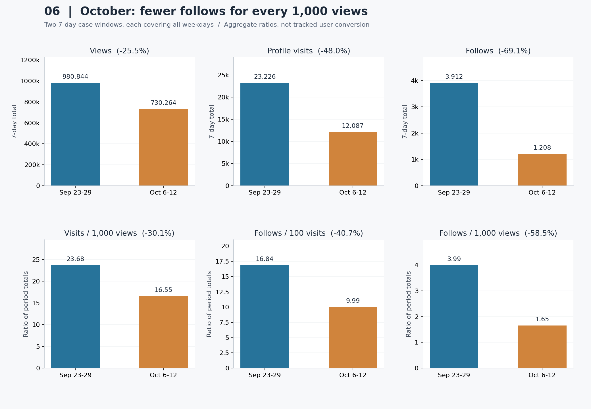
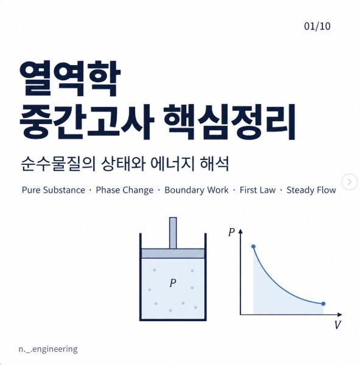

# 공대생 콘텐츠는 언제 반응을 얻을까?

**인스타그램 계정의 조회수·방문·팔로우 관계와 시기별 성과 분석**

## 1. 어떤 자료로 무엇을 알아보았나?
직접 운영하는 공대생 대상 인스타그램 계정에서 내보낸 **일별 성과 CSV 6개**를 분석했다. 
기한은 **2026년 5월 29일 ~ 10월 13일** 이다. 


| 원본 자료 | 기록된 값 | 분석에서 확인할 내용 |
| --- | --- | --- |
| Views.csv | 일별 조회수 | 콘텐츠가 얼마나 많이 조회됐는가 |
| Visits.csv | 일별 프로필 방문 | 계정 방문도 함께 많아졌는가 |
| Follows.csv | 일별 팔로우 | 팔로우도 함께 많아졌는가 |
| Interactions.csv | 일별 콘텐츠 상호작용 | 콘텐츠 반응 규모는 어떻게 달라졌는가 |
| Viewers.csv | 일별 시청자 지표 | 일별 조회 규모를 보조적으로 확인 |
| Link clicks.csv | 일별 링크 클릭 | 팔로우 외의 행동이 있었는가 |

**자료 요약:** 계정 전체의 성과를 하루 단위로 기록한 자료다. 각 CSV의 `Date`(날짜)와 `Primary`(값)를 날짜 기준으로 합쳤다. [원본 자료](data/raw) · [출처·수집 안내](DATA_SOURCE.md)

이 자료로 다음 질문에 답하고자 했다.

1. 조회수가 많은 날에는 프로필 방문과 팔로우도 많은가?
2. 조회수·방문·팔로우는 월별로 어떻게 달라졌는가?
3. 9월 급증 이후에도 높은 성과가 이어졌는가?
4. 9월과 10월의 상승 시기는 팔로우 확보에서도 비슷했는가?

## 2. 분석 결과

### 2.1 조회수가 많은 날에는 방문과 팔로우도 많았다

먼저 138일의 날짜별 조회수와 같은 날짜의 방문·팔로우를 짝지어 비교했다. **Pearson 상관계수(r)**는 두 지표가 함께 움직이는 정도를 나타낸다. -1~1 사이의 값이며, 1에 가까울수록 함께 높아지는 경향이 강하다.

| 비교한 지표 | 상관계수 r | 관측 쌍 | 한 줄 해석 |
| --- | ---: | ---: | --- |
| 조회수 ↔ 같은 날 방문 | **0.886** | 138 | 조회수가 높은 날에는 프로필 방문도 많은 경향이 뚜렷했다. |
| 조회수 ↔ 같은 날 팔로우 | **0.748** | 138 | 조회수와 팔로우도 함께 높아지는 경향이 있었다. |
| 조회수 ↔ 다음 날 팔로우 | 0.545 | 137 | 다음 날보다 같은 날 팔로우와의 관계가 더 강했다. |

**관찰:** 조회수–방문의 상관이 조회수–팔로우보다 컸다. 급증한 9/23~24 관련 날짜 쌍을 제외해도 같은 날 조회수–팔로우 상관은 0.606로 양의 관계가 남았다.


*그래프 읽기: 점 하나는 하루의 지표 쌍이다. 왼쪽은 같은 날, 오른쪽은 다음 날이며, 빨간 점은 9/23~24 관련 날짜다.*

**한 줄 정리:** 조회수가 많아진 시기에는 방문과 팔로우도 함께 많아졌지만, 방문과 팔로우가 조회수에 비례해 늘었는지는 기간별로 따로 확인해야 한다.

상관계수는 동반 변화를 보여준다. 같은 사람이 조회한 뒤 방문·팔로우했다는 뜻이나, 조회가 팔로우의 원인이라는 뜻은 아니다. [상세 상관계수](data/processed/correlations.csv)

### 2.2 월별로 보면 8월에 줄었다가 9~10월에 조회수가 커졌다

지표들이 함께 움직인다는 점을 확인했으므로, 이번에는 **언제 수준이 달라졌는지** 살펴봤다. 월마다 관측 일수가 달라 월 합계 대신 하루 평균을 비교했다.

| 월 | 포함 일수 | 조회수 일평균 | 방문 일평균 | 팔로우 일평균 |
| --- | --- | --- | --- | --- |
| 2026-05 | 3 | 17,964.7 | 338.0 | 36.7 |
| 2026-06 | 30 | 25,309.7 | 1,375.7 | 201.8 |
| 2026-07 | 31 | 25,106.1 | 710.5 | 182.5 |
| 2026-08 | 31 | 18,363.7 | 508.4 | 74.0 |
| 2026-09 | 30 | 48,673.6 | 1,229.6 | 201.3 |
| 2026-10 | 13 | 80,503.8 | 1,580.0 | 162.2 |

**표 해석:** 8월에는 조회수·방문·팔로우가 모두 7월보다 낮았다. 9월에는 세 지표가 다시 높아졌고, 10월 1~13일에는 조회수·방문이 더 높아진 반면 팔로우 일평균은 9월보다 낮았다. 5월은 3일, 10월은 13일만 포함한 부분 월이다.


*그래프 읽기: 옅은 선은 일별 값, 진한 선은 당일을 포함한 최근 7일 평균이다. 주황색 구간은 9/23~24다. 지표별 세로축 범위가 다르며 `k`는 천 단위다.*

| 같은 길이로 다시 비교 | 처음 28일: 5/29~6/25 | 마지막 28일: 9/16~10/13 |
| --- | ---: | ---: |
| 조회수 일평균 | 23,419회 | 77,839회 |
| 팔로우 일평균 | 151.2건 | 247.8건 |

**표 해석:** 마지막 28일의 조회수 일평균은 처음의 3.32배, 팔로우는 약 1.64배였다. 조회 규모가 커진 만큼 팔로우가 같은 배율로 늘지는 않았다.

**한 줄 정리:** 후반의 성과 확대는 확인되지만, 매달 꾸준히 성장한 형태는 아니며 조회수 증가폭과 팔로우 증가폭도 달랐다.

### 2.3 9월 급증 이후에는 평소 성과도 높아졌다

9/23~24에 큰 값이 나타나 월평균이 높아졌을 수 있다. 그래서 **급증 이틀을 제외한 직전·직후 14일**을 비교하고, 일부 매우 높은 값의 영향을 덜 받는 중앙값도 확인했다.

| 지표 | 직전: 9/9~22 | 직후: 9/25~10/8 | 한 줄 해석 |
| --- | ---: | ---: | --- |
| 조회수 일평균 | 27,613회 | 72,521회 | 급증 이틀을 빼도 직후가 2.63배였다. |
| 조회수 중앙값 | 10,671.5회 | 54,898.5회 | 가운데 수준의 하루도 5.14배로 높아졌다. |
| 팔로우 중앙값 | 88.5건 | 153건 | 조회수뿐 아니라 팔로우의 전형적인 하루 성과도 높아졌다. |

중앙값은 날짜별 값을 크기순으로 놓았을 때의 가운데 값이다. 직후 14일 중 **13일**의 조회수가 직전 중앙값을 넘었고, 각 구간에서 상위 2일을 빼고 평균을 비교해도 상승 방향은 같았다.

**한 줄 정리:** 9월 성과는 급증 이틀만의 결과가 아니다. 그 뒤 2주에도 전반적으로 더 높은 관심과 팔로우가 기록됐다.

[전후 분포 그래프](images/05_persistence.png) · [평균 비교 그래프](images/03_event_windows.png) · [계산표](data/processed/persistence.csv)

### 2.4 10월 상승 주간에는 조회수당 팔로우가 낮아졌다

전체 기간에는 조회수와 팔로우가 함께 움직였다. 하지만 월별 결과에서는 증가폭이 달랐으므로, **큰 상승이 시작된 두 구간을 각각 7일씩** 비교했다. 두 구간 모두 모든 요일을 한 번씩 포함한다. 전체 기간에 두 지표가 함께 움직였더라도, 특정 시기의 조회수당 팔로우 비율은 다를 수 있다.

| 지표 | 9/23~29 | 10/6~12 | 변화율 |
| --- | --- | --- | --- |
| 조회수 합계 | 980,844.0 | 730,264.0 | -25.5% |
| 방문 합계 | 23,226.0 | 12,087.0 | -48.0% |
| 팔로우 합계 | 3,912.0 | 1,208.0 | -69.1% |
| 조회수 1,000회당 방문 | 23.68 | 16.55 | -30.1% |
| 방문 100회당 팔로우 | 16.84 | 9.99 | -40.7% |
| 조회수 1,000회당 팔로우 | 3.99 | 1.65 | -58.5% |

**표 해석:** 10월 비교 주간 조회수는 9월의 74.5%였지만, 팔로우는 30.9%였다. 조회수 1,000회당 팔로우도 3.99 → 1.65건으로 **58.5% 낮아졌다.** 방문/조회와 팔로우/방문 비율도 함께 낮았다.



*그래프 읽기: 위쪽은 7일 합계, 아래쪽은 같은 구간 합계끼리 나눈 비율이다. 제목의 변화율은 9월 비교 주간 대비 10월 비교 주간의 차이다.*

**한 줄 정리:** 10월에도 많은 조회수를 얻었지만, 비교한 주간에서는 조회 규모에 비해 팔로우 확보가 약했다.

비교 기간을 하루씩 앞뒤로 옮겨도 조회수당 팔로우가 낮다는 방향은 같았다. 다만 이는 선택한 두 상승 주간의 차이이며, 시간에 따라 모든 비율이 계속 나빠졌다는 뜻은 아니다. [기간 변경 비교](data/processed/surge_windows.csv)

**비율의 뜻:** `조회수 1,000회당 팔로우 = 같은 기간 팔로우 합계 ÷ 조회수 합계 × 1,000`. 실제 사용자를 추적한 전환율이 아니라 계정 집계 지표 간 비율이다.

### 2.5 요일과 링크 클릭에서는 무엇이 보였나?

| 보조 분석 | 관찰한 결과 | 한 줄 해석 |
| --- | --- | --- |
| 요일별 조회수 | 일평균 1위는 수요일 45,775.6회, 중앙값 1위는 화요일 23,428.5회 | 평균과 중앙값의 순위가 달라 ‘수요일이 항상 유리하다’고 판단하기는 어렵다. |
| 링크 클릭 | 전체 139일 중 10/6에 171건, 10/7에 7건, 나머지 137일은 0건 | 10월 상승 시기에는 팔로우 외에 링크 클릭 178건도 기록됐다. |

**한 줄 정리:** 게시 요일을 하나로 정하기보다 콘텐츠 조건을 함께 비교하고, 자료 이용이 목표라면 링크 클릭도 성과로 볼 필요가 있다.

요일은 게시한 요일이 아니라 성과가 기록된 요일이다. 이전의 클릭 0이 링크 미운영 때문인지는 설정 이력이 필요하다. [요일별 그래프](images/04_weekday_patterns.png) · [요일별 통계](data/processed/weekday.csv)

## 3. 게시물 주제와 학기 일정은 어떻게 연결할 수 있나?

앞의 숫자는 **성과가 언제, 얼마나 달라졌는지**를 보여준다. 그 배경을 살펴보기 위해 실제 게시물 표지·캡션·게시일을 확인했고, 운영자가 제안한 방학·개강·시험 준비 맥락과 나란히 놓았다.

| 시기 | 자료에서 확인한 사실 | 가능한 해석 — 가설 |
| --- | --- | --- |
| 7~8월 | 조회수 일평균이 25,106 → 18,364회로 줄었다. | 방학 중 학습 자료 수요나 게시량·주제가 달라졌을 수 있다. |
| 9월 | 월평균은 높아졌지만, 9/1~11 조회수 일평균은 4,012회로 낮았다. | 개강 자체보다 중·하순의 구체적인 콘텐츠 기획과 반응을 함께 볼 필요가 있다. |
| 9월 하순·10월 | 9/24 ‘추석 공학수학’, 10/7 ‘중간고사 대비 열역학’ 게시물을 확인했다. | 해당 시기의 학습 필요에 맞춘 주제가 관심을 얻었을 수 있다. |

**표 해석:** 학기 일정은 콘텐츠 수요를 설명할 후보지만, 이 계정의 성과를 ‘개강해서 상승했다’는 한 가지 이유로 설명하기에는 시기별 차이가 크다.

| 추석 공학수학 · 9/24 | 중간고사 대비 열역학 · 10/7 |
| --- | --- |
|  |  |
| [인스타그램 원문](https://www.instagram.com/p/DdqwZtCE9BS/) | [인스타그램 원문](https://www.instagram.com/p/DeMOJ0skzlM/) |

**사례 해석:** 실제로 시기에 맞춘 학습 콘텐츠를 운영했다. 다만 두 게시물은 각각 상승이 시작된 다음 날 올라왔으므로, 앞선 상승의 원인으로 소급하지 않는다. 학교별 학사 일정과 전체 게시 이력은 이번 자료에 없다. 캡처는 2026-10-15 확인한 원문에서 댓글·메시지를 제외한 것이다. [확인 기록](data/context/README.md)

## 4. 종합 인사이트와 운영 판단

| 분석에서 확인한 점 | 내가 판단할 내용 |
| --- | --- |
| 조회수와 같은 날 방문·팔로우는 양의 상관관계가 있다. | 조회수가 오르는 시기에는 방문과 팔로우도 함께 점검한다. |
| 9월 급증 이틀을 제외해도 직후 2주의 성과 수준이 높았다. | 반응이 좋았던 시기에 관련 후속 콘텐츠를 이어갈 근거가 있다. |
| 10월 비교 주간에는 조회수당 팔로우가 낮았다. | 팔로우 확대가 목표라면 조회수만으로 성공을 평가하지 않는다. |
| 학기 이름만으로 설명되지 않는 시기별 차이가 있다. | 게시물의 과목·학습 목적·게시량을 기록해 성과와 함께 비교한다. |

**결론:** 이 계정은 후반에 더 많은 관심을 받았고, 관심이 높은 날에는 방문과 팔로우도 함께 많았다. 그러나 관심의 크기와 팔로우 확보의 정도는 시기마다 달랐다. 따라서 **조회수의 7일 평균, 팔로우 총량, 조회수당 팔로우**를 함께 보는 것이 다음 운영 판단에 유용하다.

**다음에 해볼 일:** 비슷한 과목·형식의 콘텐츠에서 ‘후속 편 예고’ 유무를 비교하고, 같은 7일 경과 시점의 성과를 기록한다. 다음 편을 기다릴 이유가 팔로우 확보에 도움이 되는지 확인하기 위한 제안이며, 효과가 이미 입증된 전략은 아니다.

## 5. 데이터 정제와 분석 방법

| 단계 | 적용한 기준과 이유 |
| --- | --- |
| 날짜·값 확인 | 시간순 정렬. 각 파일의 자체 기간 안에는 누락 날짜·중복 날짜·빈 숫자 값이 없었다. |
| 결측 처리 | 합친 139일 중 10/14 팔로우만 결측. 원본은 보존하고 지표 간 비교에서 그날을 제외했으며 0으로 채우지 않았다. |
| 이상치 처리 | `Q3 + 1.5 × IQR`을 넘는 값을 표시하되 실제 성과일 수 있어 삭제하지 않았다. 큰 값 제외 비교로 결과 방향을 점검했다. |
| 이동평균 | 당일과 이전 6일의 평균으로 일별 변동을 완화했다. 완전한 7일이 없는 첫 6일은 계산하지 않았다. |
| 구간별 통계 | 월별 일평균과 같은 길이의 28일·14일·7일 평균/중앙값을 비교했다. |
| 상관·비율 | 같은 날 또는 정확히 다음 날의 지표를 연결했다. 비율은 같은 구간 합계끼리 나눴고, 변화율은 `(나중 값 ÷ 이전 값 − 1) × 100`으로 계산했다. 분모가 0이면 계산하지 않았다. |

**방법 요약:** 날짜와 비교 기간을 맞춘 뒤, 이동평균·구간 통계·상관분석으로 ‘전체 흐름’과 ‘지표 간 관계’를 함께 확인했다.

추세는 시간에 따른 전체 흐름, 계절성은 주기적으로 반복되는 패턴, 노이즈는 그 밖의 변동이다. 이번에는 추세와 일별 변동을 살폈으며, 약 4.5개월만으로 학기마다 같은 패턴이 반복된다고 판단하지 않았다.

## 6. 해석할 때 기억할 한계

- **원인:** 계정 전체의 일별 집계다. 개별 사용자의 이동 경로, 게시물별 효과, 광고·학사 일정의 영향을 분리하지 못했다.
- **기간 선택:** 한 계정의 짧은 기간이며 상승 구간은 그래프를 본 뒤 골랐다. 비교 날짜를 바꾼 확인도 같은 자료의 점검이며 독립 실험은 아니다.
- **지표 정의:** 팔로우는 언팔로우를 뺀 순증가가 아니다. 시청자 수는 날짜 간 중복을 제거할 수 없어 기간 전체 고유 시청자 수로 합산하지 않았다. 원본에는 시간대·광고 포함 설정이 기록되지 않았다.

이 한계는 관측된 차이를 없애지는 않지만, 특정 콘텐츠나 학사 일정이 차이의 원인이라고 단정하는 것을 제한한다.

## 7. AI 사용 로그

| 사용 작업 | 사용 이유 | 검증 방법 |
| --- | --- | --- |
| 전처리·계산 코드 작성 | 날짜 결합과 반복 계산 자동화 | 원본과 정제값 대조, 결측·0·날짜 처리 등 테스트 10개 통과 |
| 그래프·통계 작성 | 지표 관계와 시기별 차이 시각화 | 원본에서 주요 수치 독립 재계산, 그래프 축·기간·표시 확인 |
| 해석·리포트 구성 | 자료 → 관계 → 시기별 차이 순서로 설명 | 관찰과 가설 구분, 큰 값 제외·비교 기간 변경으로 결과 방향 확인 |

**검증 요약:** 계산 결과는 원본과 대조했으며, 콘텐츠 주제·학사 일정에 대한 설명은 가설로 표시했다. 최종 판단은 이 수치와 실제 운영 이력을 함께 보고 내린다.

## 8. 재현 방법과 출처

Python 3.10 이상에서 저장소를 내려받아 실행한다. [상세 실행 안내](README.md) · [라이브러리 버전](requirements.txt) · [검증 기록](VALIDATION.md)

```bash
python -m pip install -r requirements.txt
python analysis.py
```

[analysis.py](analysis.py)는 원본에서 통계·그래프·리포트를 다시 만든다. 본문에는 핵심 분석 그래프 3개와 게시물 캡처 2개를 포함했고, 나머지 그래프와 상세 계산은 [images](images)와 [data/processed](data/processed)에 보관했다.

데이터와 게시물 캡처는 계정 소유자가 제공·공개 승인한 자료다. 제3자의 자유로운 재사용을 허용하는 공개 라이선스는 별도로 부여하지 않았다. [출처·수집 방법·이용 범위](DATA_SOURCE.md)
